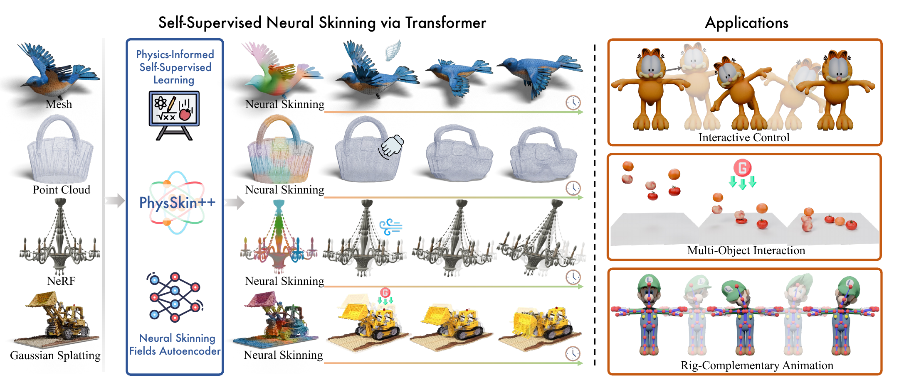
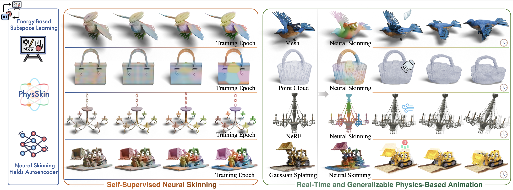
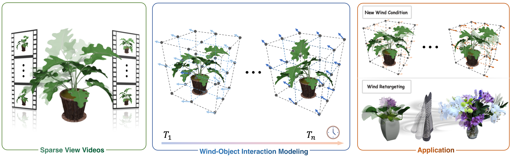

# Biography

I am a fourth-year undergraduate student majoring in **Computer Science and Technology** at [Zhejiang University](https://www.zju.edu.cn/). I am a member of the [ACEE](http://ckc.zju.edu.cn/ckcen/2022/0225/c44633a2500645/page.htm) within the prestigious [Chu Kochen Honors College](http://ckc.zju.edu.cn/ckcen/_t1906/main.psp). I currently rank **1st/281** in my cohort with a GPA of **4.78/5.00** and an average score of **93.46/100**.

Currently, I am a research intern at the [State Key Lab of CAD&CG](http://www.cad.zju.edu.cn/), working under the supervision of Prof. [Zhaopeng Cui](http://www.cad.zju.edu.cn/home/zhpcui/).

<!-- My research journey began with a focus on **physics-based 3D modeling**, synergizing physical principles with neural representations for realistic simulation and dynamic reconstruction. Building upon this, my current work investigates **physics-informed multimodal 3D reconstruction**, aiming to embed fundamental physical semantics into scene representations. I am also dedicated to advancing **feed-forward 3D reconstruction and generation**, driven by the conviction that these fields are essential for achieving **general spatial intelligence**. -->

<!-- My research centers on **physics-informed 3D scene understanding**, combining neural rendering with differentiable physics to reconstruct and reason about dynamic visual environments. I aim to build systems that can both "see" and "physically reason about" the world, ultimately enabling embodied agents to make better decisions in complex environments. -->

---

# News

- **[2026/11]** ✨ Check out [PhysStudio](https://github.com/zju3dv/PhysStudio), an open-source collection of physics-based animation demos featuring PhysSkin, DiffWind, and more!
- **[2026/10]** 📄 Our paper [PhysSkin++](https://arxiv.org/abs/2610.26067) is now available on arXiv.
- **[2026/10]** 🏆 I was awarded the **National Scholarship** (Top 0.2%).
- **[2026/02]** 🎉 Our paper [PhysSkin](https://zju3dv.github.io/PhysSkin/) was accepted to **CVPR 2026 (Highlight)**.
- **[2026/01]** 🎉 Our paper [DiffWind](https://zju3dv.github.io/DiffWind/) was accepted to **ICLR 2026**.
- **[2025/10]** 🏆 I was awarded the **National Scholarship** (Top 0.2%).
- **[2025/04]** 🔬 We received a **national-level research grant** for our SRTP project on city-scale multi-modal 3D reconstruction.
- **[2024/10]** 🏆 I was awarded the **NITORI International Scholarship**.

<button id="news-toggle" type="button" aria-expanded="false" aria-controls="news-list" hidden>Show more</button>

---

# Publications

*\* denotes equal contribution; † denotes corresponding author.*

<article class="paper">

PhysSkin++: Real-Time and Generalizable Physics-Based Animation via Self-Supervised Neural Skinning

Yuanhang Lei, Baofei Liu, Xingxuan Li, <strong>Tao Cheng</strong>, Zixuan Wang, Boming Zhao, Yujun Shen, Siyuan Huang, Ruizhen Hu, Peter Yichen Chen, Hujun Bao, Zhaopeng Cui†

arXiv preprint 2026

<a href="https://zju3dv.github.io/PhysSkin_plus/">Project</a> / <a href="https://arxiv.org/abs/2610.26067">Paper (arXiv)</a> / <a href="https://huggingface.co/papers/2610.26067">Paper (HF)</a> / <a href="https://github.com/zju3dv/PhysSkin">Code</a>

</article>

<article class="paper">

PhysSkin: Real-Time and Generalizable Physics-Based Animation via Self-Supervised Neural Skinning

Yuanhang Lei, <strong>Tao Cheng</strong>, Xingxuan Li, Boming Zhao, Siyuan Huang, Ruizhen Hu, Peter Yichen Chen, Hujun Bao, Zhaopeng Cui†

CVPR 2026 Highlight

<a href="https://zju3dv.github.io/PhysSkin/">Project</a> / <a href="https://arxiv.org/abs/2603.23194">Paper</a> / <a href="https://github.com/zju3dv/PhysSkin">Code</a>

</article>

<article class="paper">

DiffWind: Physics-Informed Differentiable Modeling of Wind-Driven Object Dynamics

Yuanhang Lei*, Boming Zhao*, Zesong Yang*, Xingxuan Li, <strong>Tao Cheng</strong>, Haocheng Peng, Ru Zhang, Yang Yang, Siyuan Huang, Yujun Shen, Ruizhen Hu, Hujun Bao, Zhaopeng Cui†

ICLR 2026

<a href="https://zju3dv.github.io/DiffWind/">Project</a> / <a href="https://arxiv.org/abs/2603.09668">Paper</a> / <a href="https://github.com/zju3dv/DiffWind">Code</a>

</article>

---

*Last updated on 2026.11.04.*